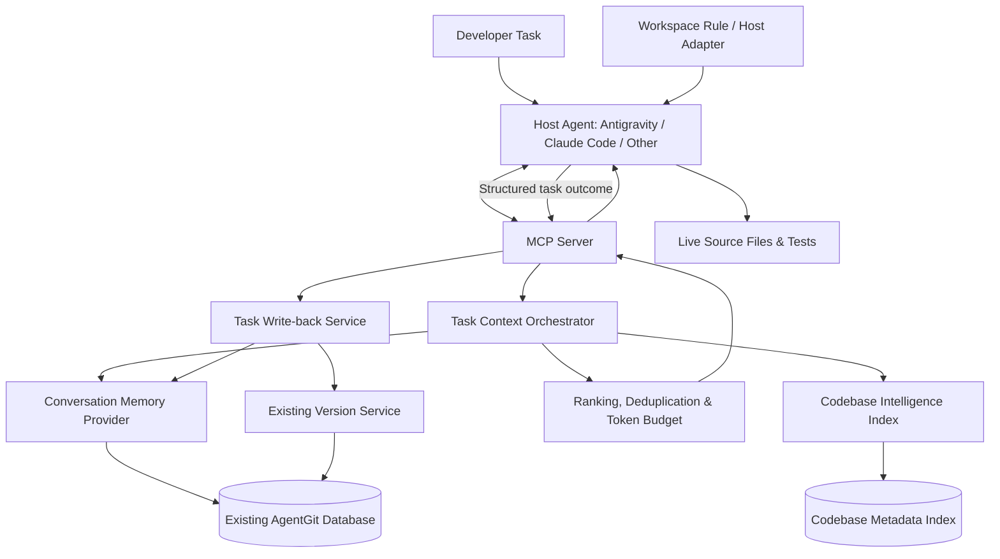
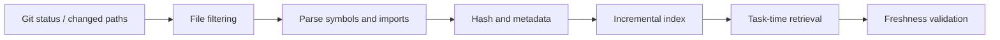

# AgentGit 2.0 — Architecture

## 1. High-level architecture

## 2. Request lifecycle

1. Host rule tells the agent to call AgentGit before substantial work.
2. Agent sends task text, repository ID, branch and optional current file.
3. Orchestrator identifies likely domains and exact terms.
4. Memory provider retrieves decisions, constraints and progress.
5. Codebase index retrieves paths, symbols and dependency candidates.
6. Freshness manager checks file hashes/index commit.
7. Ranker deduplicates and prioritizes hard constraints and direct matches.
8. Token budgeter returns a compact context with provenance and omissions.
9. Agent inspects live source files before editing.
10. Agent sends structured outcome after task completion.
11. AgentGit creates memory candidates and a versioned update according to user policy.

## 3. Trust hierarchy

1. Current user instruction and current repository state.
2. Live source files, tests and runtime observations.
3. Fresh codebase index with matching content hashes.
4. Versioned explicit decisions and constraints.
5. Summaries and semantic retrieval candidates.
6. Heuristic inferred context.

If sources conflict, flag the conflict. Never let old memory override current source code or explicit user corrections.

## 4. Index lifecycle

## 5. Graceful degradation

- MCP unavailable: host agent follows its normal workflow.
- Codebase index stale: return stale warning and request live inspection or refresh.
- No matching memory: return no memory rather than irrelevant filler.
- Token estimate unavailable: return approximate count with method.
- Unsupported language parser: use path and lexical metadata.
- Low context coverage: return `needs_more_context=true`.
