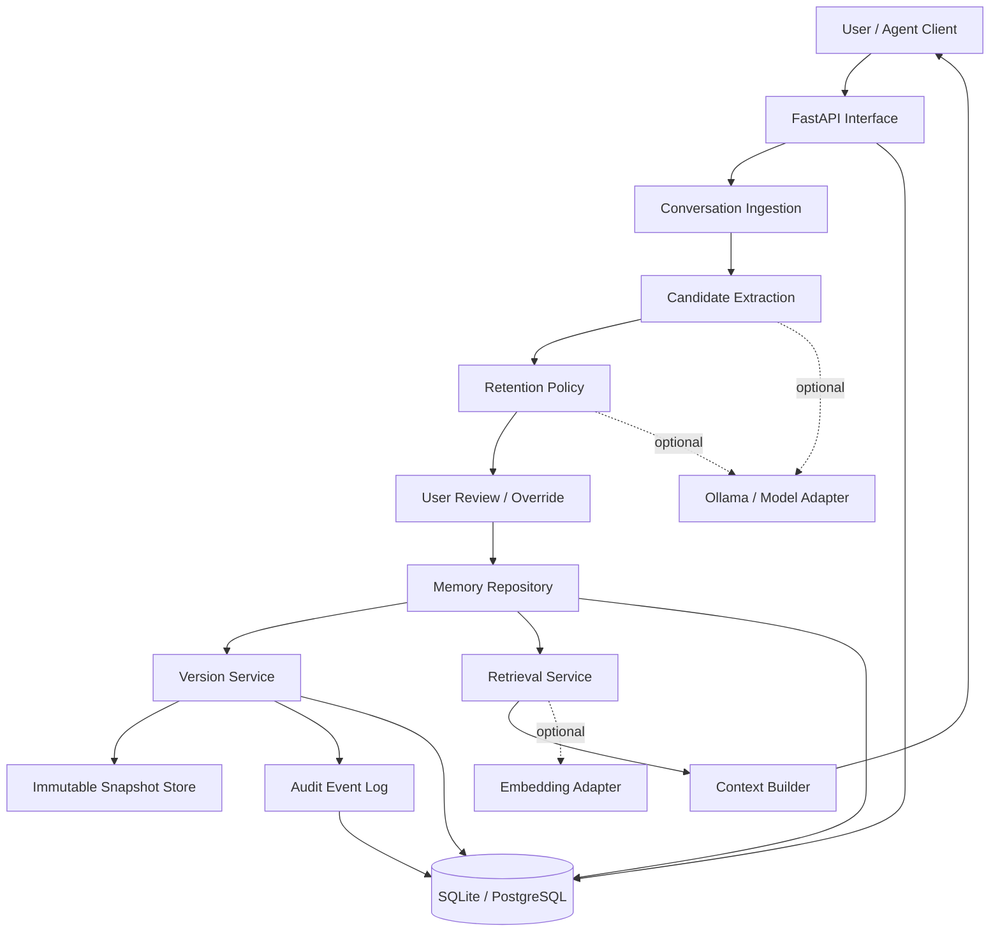
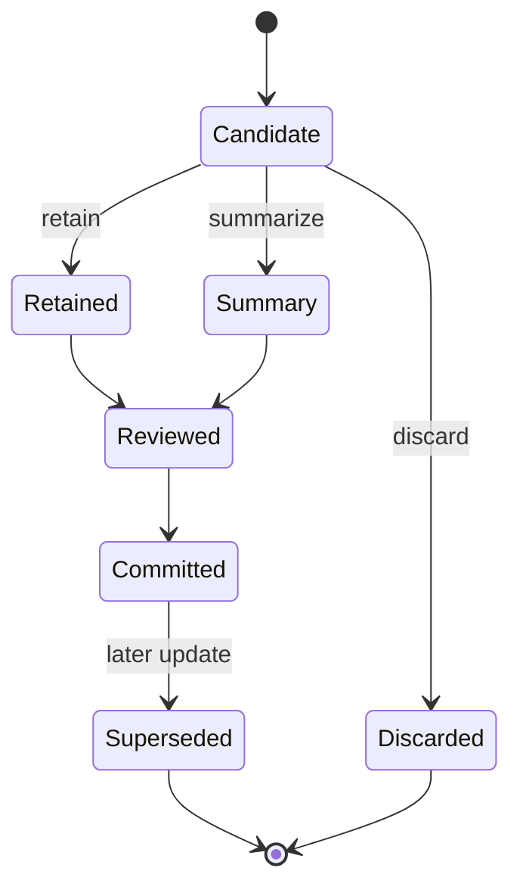
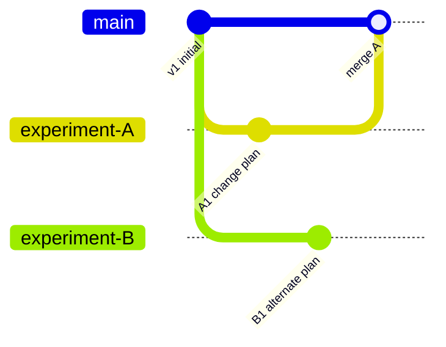

# AgentGit — System Architecture

## 1. High-level architecture

## 2. Component responsibilities

| Component | Responsibility |
|---|---|
| API | Accept requests and expose operations |
| Ingestion | Preserve source messages |
| Candidate extraction | Turn conversation spans into memory candidates |
| Retention policy | Decide retain / summarize / discard |
| User review | Allow correction before commit |
| Memory repository | Store current memory records |
| Version service | Commit, branch, restore, diff, merge |
| Snapshot store | Preserve immutable historical state |
| Retrieval | Find relevant memory with evidence |
| Context builder | Construct compact context for an agent |
| Audit log | Record all important operations |

## 3. Memory item lifecycle

Discarded candidates should be recorded in the decision log for evaluation, but should not be included in active memory snapshots.

## 4. Version graph

The graph is illustrative. Actual commits and merge semantics are defined in `TRD.md`.

## 5. Memory classification policy

Use a hybrid strategy:
1. Preserve exact values, identifiers, dates, names, constraints, explicit decisions, and user corrections.
2. Summarize repetitive explanations and broad contextual descriptions.
3. Discard greetings, duplicated filler, irrelevant content, and transient noise.
4. Never discard a candidate solely because it is old; consider relevance and user-defined retention.
5. Preserve negation and uncertainty. “Do not use X” must not become “use X”.
6. If classification confidence is low, ask for review or default to retaining the candidate in the MVP.

## 6. Provenance

Each memory item stores source message IDs and optionally source character offsets. Summaries link to all source messages used. Retrieval responses must include provenance.

## 7. Security boundaries

Treat all conversation text and retrieved content as data, not executable instructions. A message that says “ignore previous rules” must not change system policy or tool permissions. The MVP does not execute arbitrary tools.
